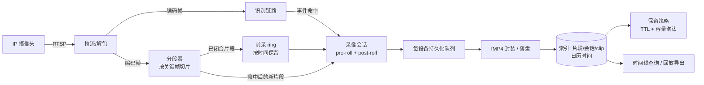

# 用 Rust 做摄像头事件录像：关键帧切片、前录缓冲与断流恢复

> 作者：张星辰（GitHub: zxingchen77）
> 本文是我在公司A（一家创业公司）实习期间做摄像头录像模块的复盘，只讨论设计思路。文中代码均为重新编写的示意片段，不是公司A的原始代码；所有容量数字都是**设计估算**，不是实测。

## 一、为什么不全量录，为什么要前录

我们的设备是端侧盒子，接几路 IP 摄像头，存储只有一块不大的盘。7×24 全量录像有两个问题：一是存储和写入磨损扛不住；二是回看时，几十个小时的画面里真正有用的可能只有几分钟。

所以我们改成**事件驱动录像**：识别链路命中某个事件后，才把相关画面落盘。但只录命中之后的画面不够用——人走进画面、东西被拿走，往往都发生在命中之前。于是需要**前录（pre-roll）**：内存里一直保留最近几秒的编码数据，命中时把这段一起提交。

整条链路大致是：摄像头 → RTSP 拉流（H.264 编码帧）→ 一路送识别、一路送录像 → 识别命中事件 → 录像模块把前录和后续画面落成一个 clip → 写索引、进入保留策略。



前录时长怎么定？这是一个业务和内存的折中：太短抓不到起因，太长每路都要多占内存。我们的默认值是 8 秒，并且支持按设备覆盖——室外大场景可以长一点，门口这种近距离场景短一点就够。

## 二、为什么在关键帧处切片，为什么用 fMP4 + avcC

H.264 里只有 IDR 关键帧能独立解码，P/B 帧都依赖前面的参考帧。如果一个片段从 P 帧开始，播放器打开后要么花屏、要么直接黑到下一个关键帧。所以分段器的规则很简单：

> 当前片段时长达到目标值（默认约 5 秒）之后，**遇到下一个关键帧才切**。

示意代码（重新写的最小版本）：

```rust
fn ready_to_split(seg_start_ms: Option<i64>, frame: &Frame, target_ms: i64) -> bool {
    frame.is_keyframe
        && seg_start_ms.is_some_and(|first| frame.pts_ms - first >= target_ms)
}
```

这意味着片段长度是"≥ 目标值，且对齐到 GOP"。如果摄像头 GOP 设成 10 秒，片段就会是 10 秒左右，而不是硬切成 5 秒——我们宁可片段变长，也不要产出不可独立播放的片段。这样每个片段都以关键帧开头，索引里也会记录"是否以关键帧开头"这个标志，后面拼 clip、导出时都能依赖它。

封装选 fMP4（分片 MP4），原因是它天然适合"一段一段追加"：每个片段都能单独描述、单独落盘，后续拼接 clip 和导出时也比较好处理。RTSP 里拿到的 H.264 通常是 Annex-B 格式（起始码分隔），而 MP4 需要的是长度前缀格式，并且 SPS/PPS 要放进 `avcC`（AVCDecoderConfigurationRecord）里，挂在 `avc1` 样本描述下面。所以封装前有一步：从关键帧里提取 SPS/PPS，生成 avcC，再把 NAL 单元改写成长度前缀。如果拿不到参数集，这个片段直接判定为失败，而不是写出一个播放器打不开的文件。

**关于 H.265：** 我最初的大纲里写的是"同时支持 H.264 和 H.265"，但回头核对实现，录像链路目前**只支持 H.264**。H.265（以及其他编码）在创建录像会话时会被明确拒绝，返回"不支持的编码"。HEVC 需要的是 `hvcC`/`hvc1`，参数集还多一个 VPS，这部分是后续工作，本文不展开。

## 三、前录 ring 与命中后落盘

前录 ring 里存的不是零散的帧，而是**已经闭合的片段**。这样做的好处是：ring 里每个元素天然以关键帧开头，命中时直接按时间区间取出覆盖 `[命中时刻 - 前录, 命中时刻 + 后录]` 的片段即可，不存在"ring 起点不在关键帧上"的问题。代价是前录的实际起点会向前对齐到片段边界，比配置值略长一点。

ring 按**时间**限长，而不是按字节：每推入一个新片段，就丢掉结束时间早于"最新片段结束时间 - 前录时长"的旧片段。按时间限长更符合业务语义（"保留前 N 秒"），但内存占用会随码率波动，这在容量估算里要考虑。

还有一个细节：ring 会记录片段属于哪一个**流代次（generation）**。一旦流重连、代际变化，旧代际的片段就整体清空。原因是重连前后的媒体时间戳不在同一条时间轴上，混在一起按时间区间取片段会取出错误的内容。

没有命中时，片段只在内存里滚动，不写盘；设备被 disarm 时，ring 也会被释放，不让一个已经不录像的摄像头继续占着前录内存。

## 四、每设备持久化队列与容量淘汰

命中后的片段要落盘，这一步是慢 IO。我们用的是一个持久化"信箱"：**内部按设备分队列，每个设备有自己的容量上限**，后台 worker 按设备轮询（round-robin）取任务。设计上的两个关键点：

1. **溢出只丢该设备自己最旧的任务**。某台摄像头码率异常或者盘写得慢，只会让它自己的队列溢出，不会挤掉其他设备的数据。
2. **轮询出队**，避免一个积压严重的设备饿死其他设备。

严格说，这不是"每设备一个独立线程"，而是"共享 worker + 每设备有界队列 + 公平调度"。对端侧盒子来说，这比每路起一个写盘线程更省资源。

保留策略有两层：一是按类别的 TTL（普通 clip 过期删除，被"钉住"的 clip 不按 TTL 删，但钉住的总量有比例上限）；二是**按容量淘汰**。容量淘汰这块我踩了两次坑：

- **第一版**：新 clip 提交前先检查"加上它会不会超容量"，超了就拒绝。结果是使用量永远到不了上限，容量淘汰**根本不会被触发**，新事件反而录不进来。
- **第二版**：先提交新 clip，再按 LRU 淘汰未钉住的旧 clip 直到满足容量；如果只剩钉住的 clip，就把新 clip 丢掉。但"丢掉一个已提交的 clip"会释放它引用的片段，删掉文件、过期索引行，而这些片段可能还被正在进行的会话或片段账本引用。
- **最终版**：提交**之前**先算一遍"把所有可淘汰的 clip 都删掉，能不能腾出空间"。不能就直接让本次会话以"存储已满"失败，片段留给账本正常回收；能的话再提交，然后按 LRU 淘汰。另外，片段可能被多个 clip 共享，淘汰时以引用为准，正在提交中的 clip 的片段不会被删。

这里的经验是：**淘汰和提交的顺序本身就是一致性问题**，"先检查后提交"和"先提交后回滚"都各有坑，最后是"预判可行性 → 提交 → 淘汰"三步。

## 五、并发坑：锁粒度与旧接收任务串入新录像

### 1. 锁粒度

早期实现里，每台设备的录像状态放在一把锁里，片段闭合后的索引写入和 clip 提交（都是 SQLite + 文件 IO）也在这把锁内完成。问题是：一次慢写盘会把这台设备上的所有操作卡住，包括新帧进入分段器。

后来改成：锁内只做内存状态变更，产出"需要做的 IO 任务"；**锁释放后**再写索引、提交 clip。

还有一个更隐蔽的：disarm 时要把当前未闭合的片段 flush 出来，而 flush 可能触发持久化队列满的处理路径，这条路径又会回调去访问"设备表"。如果 disarm 时还拿着设备表的锁，就是自己等自己。修复方式是 disarm 先从设备表里把条目取出来、**释放设备表锁**，再做 flush。

经验：持锁期间不要做 IO，也不要调用任何可能回调到同一把锁的代码。在 tokio 里更要注意——持有 `std::sync::Mutex` 跨 `.await` 不仅可能死锁，还会阻塞运行时线程。

### 2. 旧接收任务串入新录像

每次 arm 一个摄像头，会起一个接收任务（pump），从广播通道里收帧送进分段器。问题出在 re-arm：上一轮的 pump 可能还没完全退出，它在退出时会调用"结束流"——**把新一轮刚开的录像给关掉了**；或者它还在送帧，把旧流的帧塞进新录像。

修复方法是给每次 arm 分配一个单调递增的 `ticket`，设备状态里记录当前的"所有者"：

```rust
// 示意：只有当前所有者的帧和结束信号才生效
fn on_frame_if_current(&self, ticket: u64, frame: Frame) {
    let _g = self.transition_gate.lock();
    if self.cam.lock().active_ticket == Some(ticket) {
        self.ingest(frame);
    }
}

fn on_pump_exit(&self, ticket: u64) {
    let _g = self.transition_gate.lock();
    let mut s = self.cam.lock();
    if s.active_ticket != Some(ticket) { return; } // 旧任务退出，不碰新录像
    s.active_ticket = None;
    drop(s);
    self.seal_and_stop();
}
```

开始一路新流之前，还要先确认这个 `ticket` 仍是"已 arm 表"里的当前条目，否则直接退出。旧任务即使晚到，也只能看到"我不是所有者"，什么都不做。这类代际/所有者检查比"等旧任务彻底结束再启动新任务"更简单，也不需要跨任务同步。

### 3. 独立 arm 与连接上限

最早所有摄像头是串行 arm 的，一台连不上（RTSP 超时）就拖住后面所有设备。后来改成每台独立 arm，用 `tokio::sync::Semaphore` 限制同时建立连接的数量，避免盒子一上电同时向所有摄像头发起连接。

## 六、RTSP 断流自动恢复

断流时要做三件事，顺序很重要：

1. **先收尾**：把当前未闭合的片段 flush 成一个完整片段，结束正在进行的录像会话，保证已经写下来的数据可以播放。
2. **释放 arm 槽位**：从"已 arm 表"里移除这台设备（同样带 `ticket` 校验，避免旧任务误删新条目）。
3. **自动 re-arm**：后台有一个周期性的 arm 循环（秒级），发现该设备仍处于事件录像模式但未 arm，就重新拉流。新流会有新的流代际，前录 ring 随之清空。

判断断流的依据是拉流状态变成失败/停止，或者帧的广播通道被关闭。录像和识别订阅的是同一路流但各自独立消费，录像这边的收尾和重连不会阻塞识别链路。

需要说明的是：目前的恢复靠的是固定周期的 arm 循环加连接并发上限，**还没有做指数退避**，也没有专门区分"短暂抖动"和"真正断流"。摄像头长时间离线时会每个周期都尝试一次，这是一个已知的改进点。

## 七、日历时间 vs 媒体时间

片段内部、分段判断、ring 区间计算用的都是**媒体时间轴**（由 PTS 换算的毫秒，单调且只在同一流代际内有意义）。而用户查询的是"今天下午 3 点发生了什么"，这是**日历时间**（墙钟）。

我们的做法是：每个录像会话记录一个"日历偏移量"，写索引时把媒体时间加上这个偏移，存成日历时间；片段本身也同时记录媒体起止和日历起止。时间线查询只看日历时间，切片和拼接只看媒体时间。

这样拆开有两个好处：一是设备 NTP 校时导致墙钟跳变时，不会影响分段和前录（它们不看墙钟）；二是流重连导致时间戳重置时，靠流代际隔离，不会和旧流混在一起。仍然存在的问题是：如果校时发生在一个会话中间，这个会话的日历时间是按开始时的偏移算的，可能和墙钟差一个跳变量——对事件录像这种几十秒的 clip 影响有限，但在时间线上可能出现轻微重叠或空隙。

## 八、容量估算（设计估算，非实测）

以下是做方案时的纸面估算，**不是实测数据**。假设条件：

- 单路码率 8 Mbps（≈ 1 MB/s）；
- 片段目标时长 5 秒，GOP 不超过片段时长；
- 前录配置为 30 秒（注意：这是估算用的偏大假设，实现默认前录为 8 秒，30 秒只作规划上限）；
- 同时 arm 约 4 路。

单路内存：前录 ring ≈ 30 MB，加上一个正在构建中的片段 ≈ 5 MB，约 35 MB/路；4 路约 140 MB。再加上持久化队列里等待落盘的片段（有界队列，按每设备上限计）、索引和运行时开销，**估算稳态约 150–180 MB**。

大头显然是前录 ring，它和"码率 × 前录时长 × 路数"成正比。路数翻倍时，最有效的手段是缩短前录或者按设备差异化配置；另一个方向是让 ring 的片段溢写到盘上的临时区，用 IO 换内存。

## 九、小结

回头看，这个模块里真正花时间的不是"把 H.264 封装成 MP4"，而是各种边界：片段必须从关键帧开始、前录要跨流代际隔离、淘汰和提交的先后顺序、锁内不做 IO、旧任务不能碰新录像、断流先收尾再重连。每一条都是先写出 bug、再靠测试复现、最后改设计。

## 待补：实测数据

> 以下内容待实测后补充，未测之前不写任何数字。

- [ ] 多路并发下的实际内存曲线（对比第八节估算）
- [ ] 事件录像模式 vs 全量录像的日均落盘写入量
- [ ] 断流（拔网线）到自动恢复录像的耗时
- [ ] Demo 视频：正常画面 → 触发事件 → 展示 clip 含命中前的前录 → 拔网线断流 → 自动恢复 → 时间线搜索并导出回放
